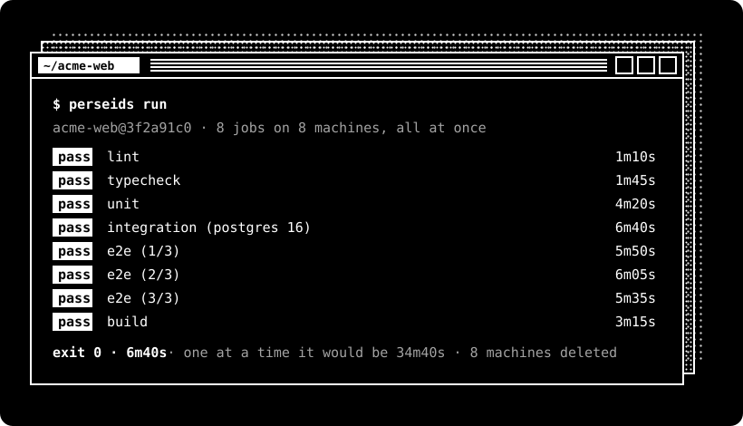

<p align="center">
  <picture>
    <source media="(prefers-color-scheme: dark)" srcset="assets/logo-dark.svg">
    
  </picture>
</p>

<p align="center">
  <b>Run every job in your GitHub Actions workflow at once, each on a fresh cloud machine.</b><br>
  Your exact local commit. One exit code. No push.
</p>

<p align="center">
  <a href="LICENSE"></a>
  
  <a href="#use-it-from-your-agent"></a>
</p>

<p align="center">
  
</p>

Your CI takes as long as its **slowest** job, not all of them added up. Perseids reads the workflow you already have,
starts one [Boat](https://boat.dev) machine per job and matrix entry in your own account, runs them in parallel, and
deletes every machine when it's done.

## Before you start

You need a [Boat](https://boat.dev) account and API key. Large machines (the default) need Boat's $20 plan, and
xlarge machines its $100 plan.

## Install

```bash
curl -fsSL https://raw.githubusercontent.com/kkeeland/perseids/main/install.sh | sh
```

It clones Perseids into `~/.perseids`, links the command into `~/.local/bin` (no sudo), and tells you the exact command
for anything missing. Needs `bash`, `git`, `jq`, `curl`, `ssh` and Ruby 2.6+. macOS has all of them except `jq`
(`brew install jq`). Run it again to update.

Or by hand:

```bash
git clone https://github.com/kkeeland/perseids ~/.perseids
mkdir -p ~/.local/bin && ln -s ~/.perseids/bin/perseids ~/.local/bin/perseids
```

## Add your Boat key

Create an API key in Boat (Settings → API keys), then:

```bash
perseids key
```

It asks once, checks the key with Boat, and saves it to `~/.config/perseids/boat.env` with mode `600`. Or set
`BOAT_API_KEY`. The key only ever goes to Boat's API. It's never printed and never copied to a machine.

## Run

```bash
cd your-repo
perseids run                 # every job in .github/workflows/ci.yml
perseids run unit e2e        # only these jobs
perseids run --dirty         # include uncommitted changes
perseids exec 'npm test'     # one command on one machine
```

## Split one slow suite across machines

```bash
perseids exec --split 8 'npx playwright test --shard={i}/{n}'
perseids exec --split 8 --files 'test/**/*_test.rb' 'ruby -Itest -e "ARGV.each { |f| require \"./#{f}\" }" {files}'
```

`{i}` and `{n}` become each machine's shard number and the count, for tools that shard on their own (`jest --shard`,
`pytest --splits {n} --group {i}`). With `--files`, the files in that commit that match the glob are split into groups
balanced by file size, the same way every time, and `{files}` becomes one machine's group, quoted (it's added at the
end if the command doesn't have it). The summary shows each shard's time, and the run fails if any shard fails.

## What you get

<table>
  <tr><td width="64"></td><td><b>Every job at once.</b> One machine per job and matrix entry, all started together.</td></tr>
  <tr><td></td><td><b>Your exact commit.</b> The commit and its history are bundled from your disk. Nothing is pushed.</td></tr>
  <tr><td></td><td><b>One exit code.</b> Pass, fail, incomplete or machine error, so scripts and agents can act on it.</td></tr>
  <tr><td></td><td><b>Agent plugins.</b> Claude Code and Codex check their own work before they say "done".</td></tr>
  <tr><td></td><td><b>Your account, your key.</b> You pay Boat directly, at Boat's price, with no markup.</td></tr>
  <tr><td></td><td><b>Nothing left running.</b> Machines are deleted when a job ends, on Ctrl-C and after a crash.</td></tr>
</table>

## Use it from your agent

**Claude Code**

```
/plugin marketplace add kkeeland/perseids
/plugin install perseids@perseids
```

Then `/ci` runs the workflow and reports the verdict.

**Codex**

```bash
codex plugin marketplace add kkeeland/perseids
codex plugin add perseids@perseids
```

**Any agent.** Add this to `AGENTS.md` or `CLAUDE.md`:

```
Before saying work is done, commit and run `perseids run`. Report the SHA and the exit code.
```

## Exit codes

| Code | Meaning |
|---|---|
| `0` | Every job passed. |
| `1` | A job failed. The summary names the step and prints the end of its log. |
| `2` | Incomplete. Something couldn't run on a machine, such as a macOS job. Never reported as green. |
| `99` | A machine failed, not your code. Run it again. |

## Settings

| Variable | Default | Effect |
|---|---|---|
| `PERSEIDS_TYPE` | `large` | Machine size: `small`, `default`, `large` (8 vCPU, 16 GB) or `xlarge` (16 vCPU). |
| `PERSEIDS_MAX` | `10` | Machines at once, across every run on your account. |
| `PERSEIDS_TTL` | `7200` | Seconds before a machine stops itself. |
| `PERSEIDS_TAIL` | `40` | Log lines printed for each failed job. |
| `PERSEIDS_EVENT` | `push` | The `github.event_name` that `if:` conditions see. |

Other commands: `perseids ls` lists your running machines, and `perseids reap` deletes any left by a run that was
killed.

## What it runs

`services:` (with health checks), `strategy.matrix` (`include` and `exclude`), `needs:`, `if:` and `${{ }}`
expressions, `env`, `working-directory`, `GITHUB_ENV`, `GITHUB_PATH`, `GITHUB_OUTPUT`, `continue-on-error`,
`timeout-minutes`, and the `setup-node`, `setup-go`, `setup-python`, `setup-java`, `setup-ruby`, `pnpm`, `bun`, `deno`,
`uv` and `rust` actions.

It doesn't run macOS or Windows jobs, `container:` jobs, reusable workflows, or other marketplace actions. Those are
reported as skipped and the run exits `2`. Secrets are never sent to machines.

## Custom machines

Need a database server, browsers or a pinned toolchain? Put the setup in `.perseids/setup.sh`, run
`perseids image build` once, and commit the `.perseids/image` file it writes.

## Perseids Cloud

Don't want a Boat account? Perseids Cloud runs the machines for you: sign in with GitHub, pay per minute, with caps on
spend. It's in early access.

## Development

```bash
ruby test/runner_test.rb     # the runner, on your machine
sh test/install_test.sh      # install.sh, in a throwaway HOME
perseids run                 # this repo's own CI, on machines
```

## License

[MIT](LICENSE) © 2026 Kevin Keeland
